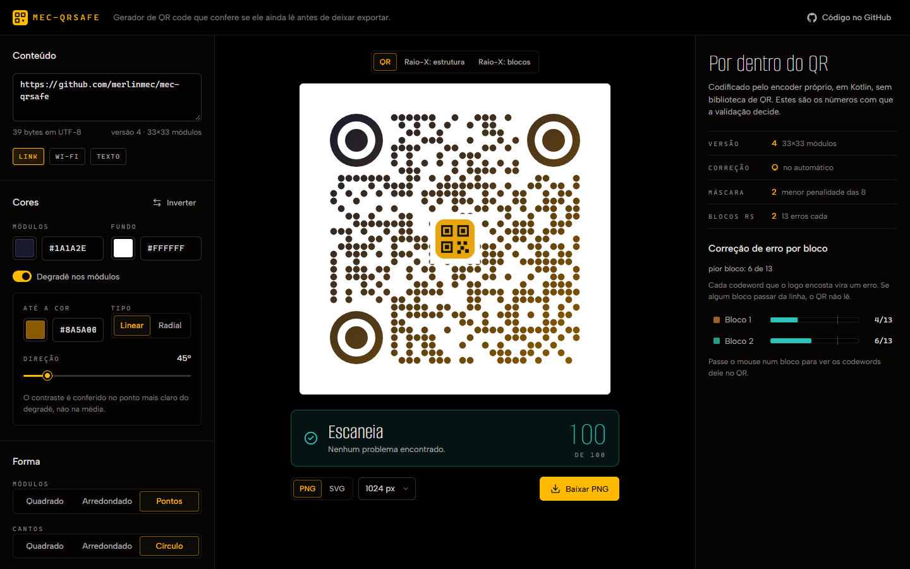
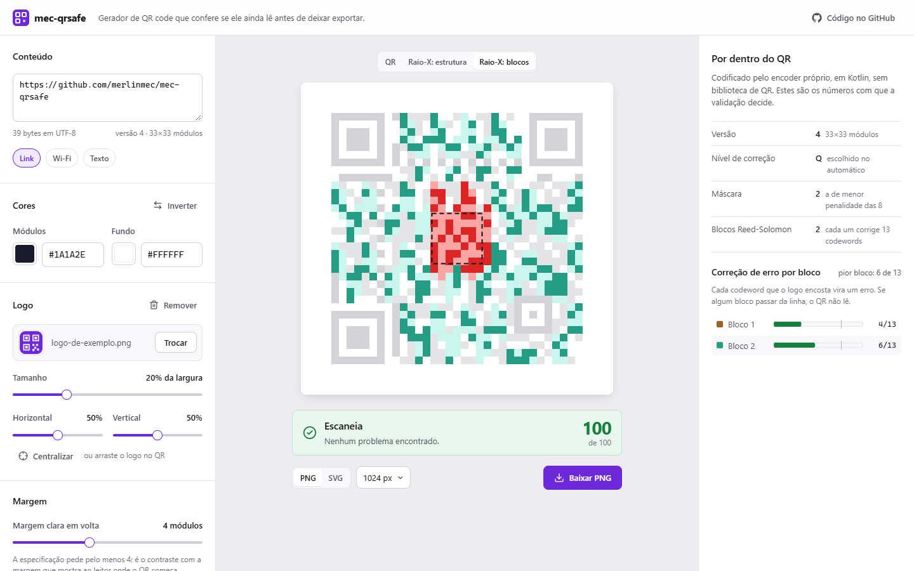

# mec-qrsafe

Gerador de QR codes customizáveis com um diferencial central: um motor de
**validação de escaneabilidade em tempo real**, que garante que a
customização visual (cores e degradê, forma dos módulos e dos cantos, logo,
margem) escolhida ainda resulta num QR
legível por câmera — e recusa deixar exportar o que não passar. Usa um
encoder QR implementado do zero (Reed-Solomon sobre GF(256), sem lib
pronta tipo ZXing).

**Demo pública: https://mec-qrsafe-editor.onrender.com** (o editor abre na
hora; a API roda num servidor gratuito que dorme e, se estiver parada, leva
cerca de um minuto pra acordar — o editor avisa e começa a validar sozinho.
Como funciona em [`docs/DEMO.md`](docs/DEMO.md)).





Antes de mexer no código, leia o **`DECISOES-E-TRADEOFFS.txt`**:
arquitetura completa (módulos, API, regras de negócio) e por que cada
decisão foi tomada. `PRODUCT.md` e `DESIGN.md` registram o público e o
sistema visual do editor.

## Estrutura

```
mec-qrsafe/
├── qr-engine/       encoder QR do zero — biblioteca pura, sem Spring
├── qr-validation/   motor de escaneabilidade — biblioteca pura, sem Spring
├── qr-render/       geração de SVG/PNG a partir da matriz — sem Spring
├── qr-api/          único módulo com Spring Boot
└── frontend/        editor em React + Vite + TypeScript, renderer canvas próprio
```

## Rodar

Requer Java 21 e Maven (ou o `JAVA_HOME` apontando pra um JDK 21 — nesta
máquina, `C:\Program Files\Java\jdk-21`, mesmo que o `JAVA_HOME` padrão da
sessão aponte pro 17) e Node 22.12+.

```
mvn install                           # compila e testa os módulos
mvn -pl qr-api spring-boot:run        # sobe a API em localhost:8080

cd frontend
npm install
npm run dev                           # editor em localhost:5173 (o /api vai pra 8080)
npm test                              # testes do front (Vitest)
```

## Status (2026-10-14)

**Encoder completo**, do zero, sem lib pronta: byte mode (UTF-8), as 40
versões nos 4 níveis de correção, Reed-Solomon com intercalação de
blocos, padrões fixos, as 8 máscaras com as penalidades N1-N4 e
format/version info com BCH. A matriz sai com a quiet zone, com o tipo de
cada módulo (finder, timing, dado...) e com qual codeword cada módulo de
dado carrega, que é o que o validador consulta.

Testado em três camadas, como prevê a seção 4 de
`DECISOES-E-TRADEOFFS.txt`:

1. vetores da especificação (Reed-Solomon, format/version info,
   capacidade, posições dos alignment patterns);
2. matriz idêntica à do ZXing, módulo a módulo e com a mesma máscara
   escolhida, nas 40 versões × 4 níveis;
3. leitura real: o QR vira imagem e o leitor do ZXing devolve o texto
   original (acentos, japonês e emoji incluídos).

O ZXing entra só nos testes, como referência e como leitor.

**Validação completa**: contraste, logo encostando em padrões fixos
(finder, timing, format info), margem mínima de 4 módulos e a área do
logo pela conta real — quantos codewords ele destrói em cada bloco contra
quantos aquele bloco corrige. No modo AUTO, a correção sobe sozinha (M →
Q → H) até o logo caber. Conferido contra o leitor do ZXing: a regra de
área bloqueia exatamente quando o decodificador falha, e tudo que as
regras aprovam é lido da imagem.

### API

Os três endpoints recebem o mesmo corpo:

| Endpoint | Devolve |
|---|---|
| `POST /api/v1/qr-codes/validate` | só o resultado da validação |
| `POST /api/v1/qr-codes/preview` | validação + a matriz crua pro renderer do front + onde vai a placa do logo |
| `POST /api/v1/qr-codes/export?format=svg\|png&size=1024` | o arquivo final, ou **422** com os motivos se o QR não passar |

O export revalida no servidor: o arquivo só sai se a validação aprovar,
independente do que a interface mostrou. O logo vai sobre uma placa na
cor clara, e a imagem dele (opcional, `logo.imageDataUrl`) é aceita só
como PNG ou JPEG de até 1 MB e 2048 px, conferida antes de ser
decodificada. Corpos acima de 2 MB são recusados antes de o JSON ser
lido.

```json
{
  "content": { "type": "STATIC", "value": "https://exemplo.com.br/cardapio?mesa=12" },
  "style": {
    "darkColor": "#000000", "lightColor": "#FFFFFF",
    "logo": { "widthPercent": 25, "centerXPercent": 50, "centerYPercent": 50 },
    "quietZoneModules": 4,
    "moduleShape": "DOTS",
    "eyeShape": "CIRCLE",
    "gradient": { "type": "LINEAR", "endColor": "#6D28D9", "angleDegrees": 45 }
  },
  "errorCorrection": "AUTO"
}
```

Resposta do `/validate`:

```json
{ "score": 1.0, "passed": true, "violations": [], "errorCorrectionLevel": "H", "version": 5 }
```

No `/preview`, a matriz vem como uma string por linha, um caractere por
módulo: a letra é o tipo (`F` finder, `S` separador, `A` alignment, `T`
timing, `I` format info, `V` version info, `K` dark module, `D` dado, `Q`
quiet zone) e a caixa é a cor (maiúscula escuro, minúscula claro).

### Editor

O frontend desenha a matriz do `/preview` num canvas próprio (nenhuma
lib de QR no browser) e valida a cada ajuste: espera o usuário parar de
mexer, cancela a requisição anterior, e só pede uma matriz nova quando
conteúdo, logo, margem ou nível mudam — cor repinta local. Além do QR e
do veredito, mostra a conta: versão, nível, máscara e a correção de erro
bloco a bloco. O raio-X pinta cada módulo pelo tipo ou pelo bloco
Reed-Solomon do seu codeword, com os destruídos pelo logo em vermelho, e
passar o mouse num bloco acende os codewords dele. O logo pode ser
arrastado direto no QR, e o botão de baixar fica travado (com o motivo
escrito) enquanto o QR não passa.
